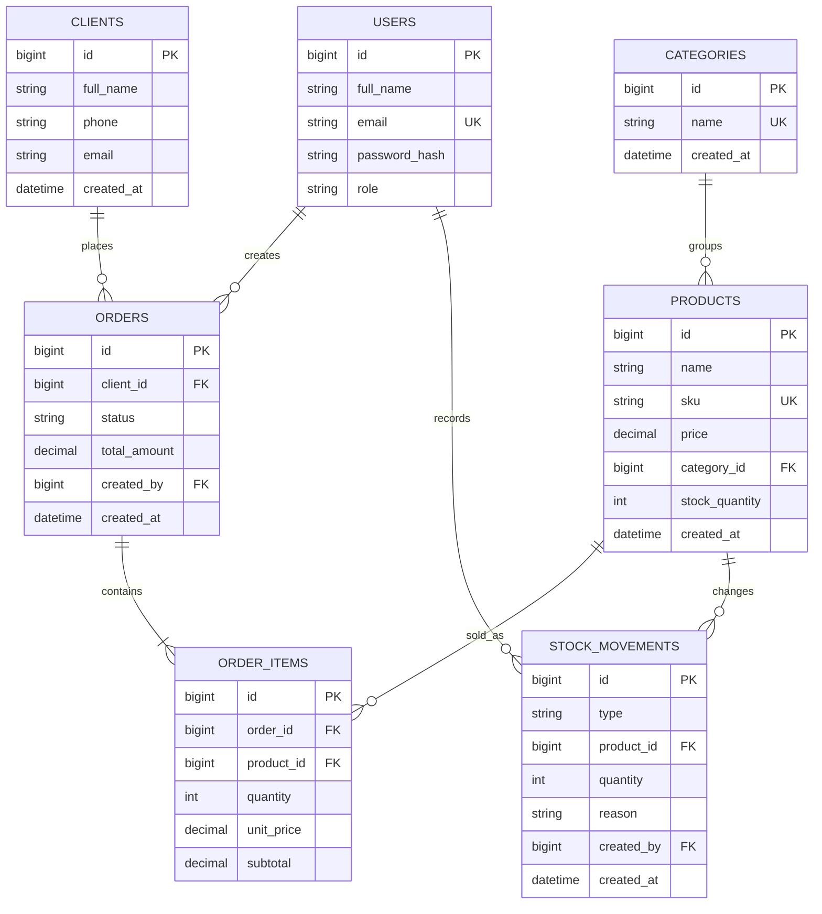

# StockFlow — ERD

`server/db/schema.sql` is the executable source of truth for types, checks, foreign keys, uniqueness and indexes. `order_items` enforces one row per product per order; adding the same product again increments its quantity.
