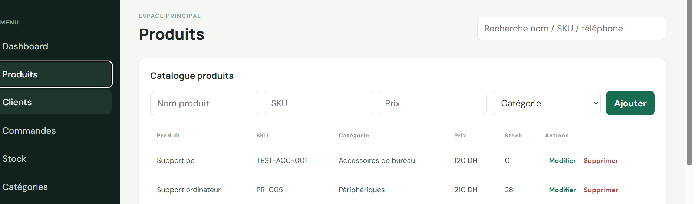
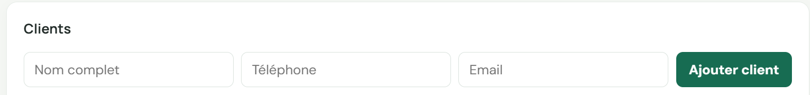

# Rapport technique — StockFlow

## 1. Présentation

StockFlow est une application web de gestion de stock conçue comme un mini ERP. Elle permet à un utilisateur connecté de consulter et gérer les produits, catégories, clients, commandes et mouvements de stock. Le projet est organisé en trois parties : une interface React, une API REST Express et une base PostgreSQL.

## 2. Besoin couvert

L’application centralise le catalogue et les opérations courantes : créer les produits et les associer à une catégorie, rechercher et parcourir le catalogue, gérer les coordonnées des clients, préparer une commande, puis suivre les mouvements qui mettent à jour les quantités disponibles. Les règles de stock empêchent les sorties supérieures à la quantité disponible.

## 3. Architecture et technologies

- **Frontend :** React et Vite. L’interface regroupe un tableau de bord et des vues de gestion pour les produits, les catégories, les clients, les commandes et le stock.
- **Backend :** Node.js et Express. L’API REST expose les opérations métier, applique l’authentification et valide les données entrantes.
- **Persistance :** PostgreSQL. Les tables, clés étrangères, index et contraintes sont définis dans `server/db/schema.sql`.
- **Authentification et validation :** jetons JWT, mots de passe hachés avec bcryptjs, validation des entrées avec Zod et contrôle des rôles.
- **Environnement local :** PostgreSQL peut être lancé avec Docker Compose.

## 4. Modèle de données

Le schéma comprend sept tables principales :

- `users` : comptes et rôles (`admin`, `staff`).
- `categories` : catégories uniques.
- `products` : nom, SKU unique, prix, catégorie et quantité disponible.
- `clients` : nom complet, téléphone et adresse e-mail.
- `orders` : client, statut, total et créateur.
- `order_items` : produits, quantités, prix unitaire enregistré et sous-total.
- `stock_movements` : journal des entrées (`IN`) et sorties (`OUT`), avec motif et utilisateur.

Les relations sont décrites dans `docs/ERD.md`. Les contraintes SQL contrôlent notamment l’unicité des SKU et noms de catégories, les clés étrangères et les quantités/prix non négatifs.

## 5. Fonctionnalités livrées

- Connexion et récupération du profil utilisateur.
- Tableau de bord avec nombre de produits, clients, commandes du jour et produits les plus vendus.
- Catalogue avec recherche par nom/SKU et pagination.
- Création, modification et consultation des produits ; suppression réservée au rôle administrateur.
- Création et modification des catégories, réservées à l’administrateur.
- Création et modification des clients (nom, téléphone, e-mail).
- Création de commandes en brouillon, ajout de lignes, calcul du montant total et transitions de statut autorisées.
- Confirmation d’une commande avec vérification du stock et enregistrement des sorties correspondantes.
- Entrées/sorties manuelles de stock et consultation de l’historique.
- Données de démonstration fournies par `server/db/seed.js`.

## 6. Règles métier et cohérence des données

Les lignes d’une commande ne sont modifiables qu’à l’état brouillon. Le prix unitaire est enregistré lors de l’ajout de la ligne. La confirmation vérifie les disponibilités, met à jour les quantités et ajoute les mouvements de stock dans une transaction PostgreSQL. Les entrées et sorties manuelles suivent aussi une transaction et verrouillent le produit pendant la vérification et la mise à jour. Une contrainte SQL interdit les quantités négatives.

## 7. Sécurité implémentée

- Les mots de passe des comptes de démonstration sont hachés avec bcryptjs.
- L’accès aux routes métier nécessite un jeton JWT valide.
- Des contrôles de rôle restreignent certaines opérations.
- Les corps de requête sont validés côté serveur avec Zod.
- Les requêtes SQL utilisent des paramètres.
- Helmet et une limitation du débit de connexion sont configurés.
- Les secrets sont prévus dans `server/.env`, ignoré par Git ; seul `.env.example` est livré.

Ces mesures conviennent au périmètre d’une démonstration locale ; elles ne remplacent pas une revue de sécurité avant mise en production.

## 8. Lancement et données de démonstration

Les étapes complètes sont dans [`README.md`](../README.md). En bref : démarrer PostgreSQL avec `docker compose up -d postgres`, configurer `server/.env`, installer les dépendances, exécuter `npm run db:init` et `npm run db:seed` depuis `server`, puis lancer l’API et le client dans deux terminaux.

Le seed fournit 1 compte administrateur, 2 comptes staff, 5 catégories, 15 produits, 5 clients et 10 commandes, ainsi que des mouvements de stock. Il réinitialise les données du schéma StockFlow avant de les recréer : ne pas l’exécuter sur une base à préserver.

## 9. Vérifications effectuées

- La compilation de production du frontend a été exécutée avec `npm run build` et s’est terminée avec succès.
- Les principaux parcours API ont été vérifiés manuellement pendant le développement : authentification, accès au tableau de bord, pagination, refus d’une sortie de stock insuffisante, contrôle de rôle à la suppression et mise à jour du stock lors de la confirmation d’une commande.
- Aucun jeu de tests automatisés frontend/backend n’est fourni dans cette version.

## 10. Améliorations envisageables

- Ajouter des tests automatisés unitaires et d’intégration pour les règles métier et les routes.
- Ajouter des filtres et de la pagination aux vues des commandes, clients et mouvements de stock.
- Mettre en place une gestion de configuration et de déploiement adaptée à un environnement de production, avec sauvegardes et supervision.
- Ajouter une documentation OpenAPI pour décrire et explorer l’API.

## 11. Arborescence

```text
stockflow/
├── client/            # Interface React/Vite
├── server/            # API Express et scripts PostgreSQL
├── docs/ERD.md        # Diagramme des relations entre tables
├── docker-compose.yml # PostgreSQL pour le développement local
└── README.md          # Installation, configuration et utilisation
```


## Captures de l’application

La première image montre le catalogue des produits. La deuxième capture le formulaire client après recadrage pour retirer les coordonnées visibles sur l’image source.





